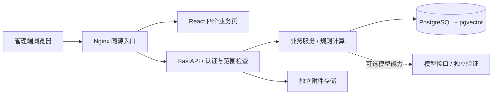

# JIUYE · 就业数智系统工程案例

**把风险识别、学生理解、帮扶记录与岗位分析，组织成可审查的就业管理流程。**

JIUYE 围绕高校就业管理的四条工作主线展开：通过预警驾驶舱观察风险，通过学生画像理解个体情况，通过帮扶台账记录行动，通过岗位解析与匹配辅助岗位分析。

这是依据现存代码整理的 **工程参考案例**。公开版本保留前后端实现、数据库迁移、测试及独立部署入口，使用专门构造的示例数据，并公开验证记录与已知限制。源码存在、构建成功和业务验收通过分别记录。

**React · TypeScript · FastAPI · PostgreSQL · pgvector**

## 从四条业务主线理解项目

| 入口 | 工作内容 | 源码位置 |
|---|---|---|
| 预警驾驶舱 | 查看风险分布、趋势与学生明细；规则计算为排查提供线索 | [`Dashboard.tsx`](frontend/src/pages/Dashboard.tsx) · [`risk.py`](backend/app/services/risk.py) |
| 学生画像 | 汇集学生信息、行为与画像，支持筛选及进一步查看 | [`Profiles.tsx`](frontend/src/pages/Profiles.tsx) · [`profiles.py`](backend/app/services/profiles.py) |
| 帮扶台账 | 记录帮扶事项与跟进，保留操作与权限检查 | [`Assist.tsx`](frontend/src/pages/Assist.tsx) · [`assist.py`](backend/app/services/assist.py) |
| 岗位解析与匹配 | 组织岗位信息、解析结果、匹配与反馈；模型能力单独验证 | [`Jobs.tsx`](frontend/src/pages/Jobs.tsx) · [`matching.py`](backend/app/services/matching.py) |

适合阅读业务系统结构、审查权限与数据流、研究规则计算与模型接口的分工，以及在明确边界内继续开发。部署真实业务数据前，需要独立完成安全、隐私与业务验收。

## 当前交付范围

| 范围 | 本仓库提供 | 验证边界 |
|---|---|---|
| 登录与四个管理页 | React 源码、API 调用及对应后端 | 实际构建和测试结果见验证记录 |
| 后端业务模块 | 数据模型、服务、API、完整现存迁移与测试 | 不将模块存在等同于完整 UI 或端到端验收 |
| 导入、招聘会、访企、场景统计、报表 | 对应后端实现 | 部分流程尚未完成独立部署验证 |
| 模型接口 | provider 抽象、解析与评估代码 | 单元测试中的确定性 provider 不代表真实模型效果 |
| 学生端与完整离线交付 | 后端中保留相关代码 | 缺少部分前端/构建输入，不提供完整离线成品 |

**请先查看 [验证记录](docs/verification.md) 和 [已知限制](docs/known-limitations.md)。** 本仓库不声明已达到生产验收，也不以历史判定结果替代当前测试。

## 技术结构



前端使用 React、TypeScript、Vite、Ant Design 与 ECharts；后端使用 FastAPI、SQLAlchemy 与 Alembic。角色与学院范围在服务端检查，生产与演示档位由配置约束。更多说明见 [架构](docs/architecture.md) 与 [案例范围](docs/case-scope.md)。

## 部署与复现

准备 Python 3.11、Node.js 22，以及可运行 Linux 容器的 Docker Engine / Docker Desktop 和 Compose v2。新案例使用独立配置、容器网络与数据卷；初次安装依赖和拉取镜像需要联网，运行网络按内部网络配置。

```bash
git clone https://github.com/zhuyishehui076-ux/jiuye-case-study.git
cd jiuye-case-study
python deploy/case.py init test
python deploy/case.py check test
python deploy/case.py build test
python deploy/case.py test test
```

这是公开的复现入口，实际执行状态以验证记录为准。数据库测试明确要求 PostgreSQL，缺少数据库或配置会失败。演示部署、生成数据、取得本地随机账号的步骤见 [部署说明](docs/deployment.md)；不要把此入口指向已有业务数据库。

## 示例与数据边界

[示例说明](examples/README.md) 区分数据库种子、接口模板和说明性 JSON。内置种子代码使用固定随机种子构造模拟场景；账号密码在每次新建独立环境时单独生成。仓库不提供可用的固定密码、真实学生库、联系方式、部署密钥或私人恢复档案。

## 阅读顺序

1. [案例范围](docs/case-scope.md)：哪些功能有代码，哪些尚未验证。
2. [架构](docs/architecture.md)：前端、API、权限、存储和模型接口。
3. [部署说明](docs/deployment.md)：测试、演示与配置边界。
4. [验证记录](docs/verification.md)：命令、环境、结果与未执行项。
5. [依赖说明](docs/dependencies.md)：版本基线、适用安全公告与许可来源。

## 许可与维护

项目自有代码按 [Apache License 2.0](LICENSE) 发布。第三方内容保留各自许可证，见 [THIRD_PARTY_NOTICES.md](THIRD_PARTY_NOTICES.md)。

仓库保持开放，欢迎提交可复现问题和范围明确的改进。维护与贡献约定见 [CONTRIBUTING.md](CONTRIBUTING.md)；安全问题请遵循 [SECURITY.md](SECURITY.md)。项目没有承诺持续更新周期、服务等级或真实业务部署支持。
